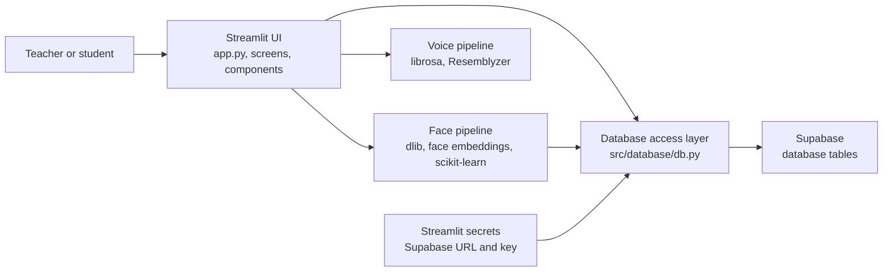
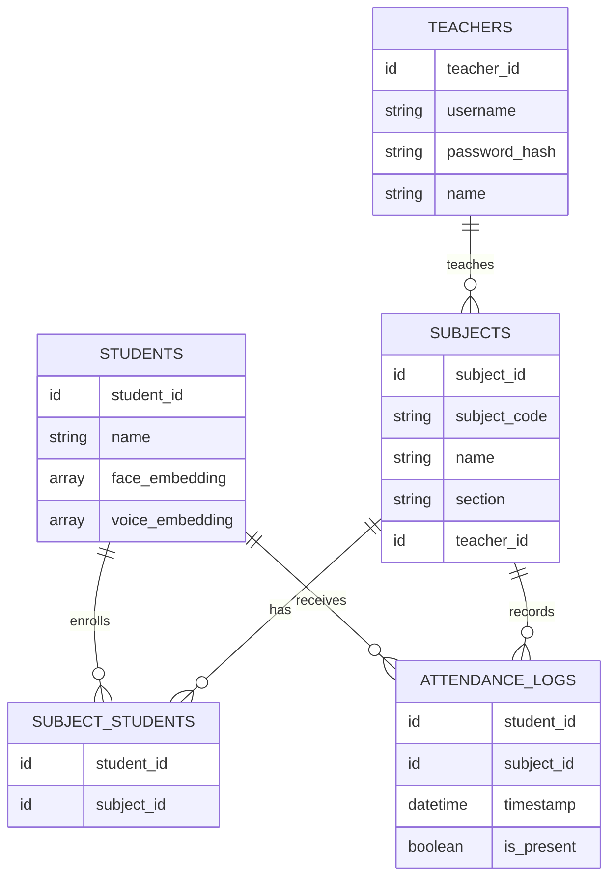
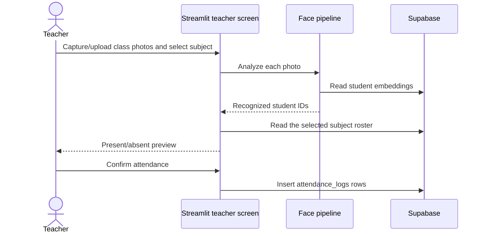

# Attendifly System Architecture

## Overview

Attendifly is a single-process Streamlit application for classroom attendance. It provides teacher and student screens, runs face and voice recognition in the Python application process, and reads/writes application data through the Supabase client.

There is no separate API server, task queue, or model-serving service in this repository. Streamlit reruns the app in response to user interactions; `st.session_state` holds the current login context and temporary UI data.

## High-level component view

Recognition is performed locally by the app process, not by Supabase. The pipelines retrieve or receive embeddings and input media, return recognition results to the UI, and the UI presents those results for confirmation before writing attendance records.

## Main components

| Component | Responsibility |
|---|---|
| `app.py` | Streamlit entry point. Chooses the home, teacher, or student view based on session state and handles `join-code` URL parameters. |
| `src/screens/home.py` | Portal selection for teachers and students. |
| `src/screens/teacher.py` | Teacher registration/login, dashboard tabs, subject management, attendance capture, and attendance history. |
| `src/screens/student.py` | Face-based student login/registration, student dashboard, enrollment, and attendance history. |
| `src/components/` | Reusable UI and dialogs for subject creation/sharing, photo capture, enrollment, attendance results, and voice attendance. |
| `src/pipelines/face_pipeline.py` | Loads dlib face models, extracts 128-dimensional face embeddings, trains an SVM over saved student embeddings, and recognizes faces. |
| `src/pipelines/voice_pipeline.py` | Loads the Resemblyzer encoder, converts audio to embeddings, splits longer recordings into speech segments, and matches voices by similarity. |
| `src/database/db.py` | Supabase CRUD functions for teachers, students, subjects, enrollments, and attendance logs; hashes and checks teacher passwords with bcrypt. |
| `src/database/config.py` | Creates the Supabase client using `SUPABASE_URL` and `SUPABASE_SECRET_KEY` from Streamlit secrets. |
| `src/ui/base_layout.py` | Shared page and background styling. |

## Data model

The application code expects these Supabase tables and relationships. The repository does not include database migrations or a canonical SQL schema, so exact column types, constraints, indexes, and row-level security policies must be confirmed in the Supabase project.

The `password` column name used by the code contains a bcrypt hash, not the original teacher password. Student face and optional voice embeddings are stored on the student record. Classroom photos and voice recordings are processed from the UI; the attendance flows shown here save attendance rows, not the source media.

## Key workflows

### Teacher login and class setup

1. The teacher chooses the teacher portal and registers or logs in.
2. Registration stores a bcrypt hash; login retrieves the teacher record and checks the submitted password against that hash.
3. A teacher creates a subject. Subject records belong to a teacher and have a join code (`subject_code`).
4. The teacher can share the subject code or a URL containing `?join-code=...`; a QR code for that URL is generated in the app with Segno.

### Student profile and enrollment

1. A student opens the student portal and captures a face image.
2. The face pipeline compares it with student embeddings. A recognized face starts a student session; otherwise the student can register with a name and a newly extracted face embedding.
3. Voice enrollment is optional. When provided, the audio is converted to a voice embedding and stored with the student.
4. Students enroll using a subject code or the shared join link. The app creates a row in `subject_students`.

### Face attendance

The face pipeline detects faces, computes embeddings, and compares them against an SVM trained from saved student embeddings. The teacher screen then intersects recognized IDs with the selected subject's enrolled students and prepares one present/absent record per roster student. The teacher reviews and confirms those records before they are inserted.

### Voice attendance

1. The teacher selects a subject and records classroom audio.
2. The app reads enrolled students and selects those with stored voice embeddings.
3. Librosa loads the recording and splits it into speech segments; segments shorter than half a second are skipped. Resemblyzer produces an embedding per segment, matched against enrolled voice embeddings.
4. The UI shows a present/absent preview for the roster. Confirmation inserts the attendance rows.

### Attendance history

Teacher history reads logs for subjects belonging to that teacher and groups them by timestamp and subject. Student history reads that student's logs and associated subjects.

## Runtime and configuration

- Start the app from the repository root with `streamlit run app.py`.
- For AWS ECS, build the image from the root `Dockerfile` and run it as a Fargate task listening on port `8501`; see [DEPLOYMENT.md](./DEPLOYMENT.md) for ECR, Secrets Manager, and service setup.
- Install Python dependencies from `requirements.txt`; the main runtime dependencies include Streamlit, NumPy/pandas, dlib and face-recognition models, scikit-learn, librosa/Resemblyzer, Supabase, bcrypt, Pillow, and Segno.
- Configure `SUPABASE_URL` and `SUPABASE_SECRET_KEY` in Streamlit secrets locally, or inject them as environment variables from AWS Secrets Manager in ECS.
- Set `APP_BASE_URL` to the public application URL in ECS so generated subject links and QR codes point to the deployed app.
- Streamlit session state holds login/role selection, current teacher tab, captured attendance photos, and unconfirmed voice attendance results. It is not a durable store.
- dlib models and the voice encoder are cached as Streamlit resources. Face classification is built from student embeddings retrieved from Supabase.

## Important implementation boundaries

- Supabase is accessed directly from the Streamlit application; no repository-defined backend API mediates database access.
- The database schema and Supabase authorization policies are managed outside the visible application source. They should be checked in the Supabase project, especially because the UI uses the Supabase key configured in Streamlit secrets.
- The face classifier is trained from available student embeddings across the student table; the selected subject roster is applied afterward when forming attendance results.
- Recognition is probabilistic/threshold-based and results are explicitly reviewable before saving. A teacher confirmation is the persistence boundary for an attendance session.
